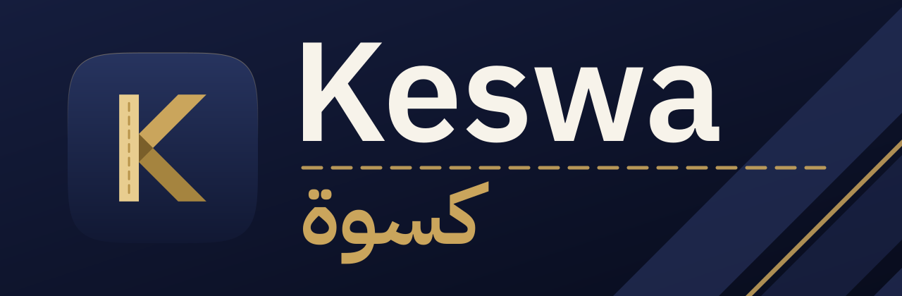
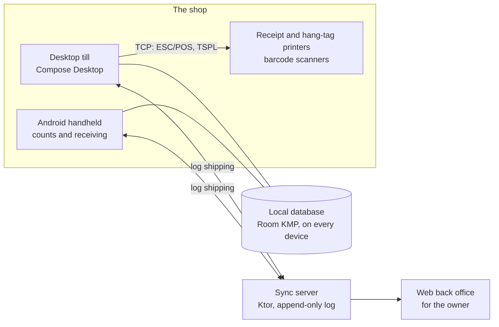

<div align="center">



**Offline-first point of sale for clothing shops.**<br>
Retail and wholesale. Desktop tills and Android handhelds. Arabic and English.

[](https://github.com/isllamm/Keswa/actions/workflows/ci.yml)


[Features](#features) · [How it fits together](#how-it-fits-together) · [Getting started](#getting-started) · [Project layout](#project-layout) · [Documentation](#documentation)

</div>

---

*Keswa (كسوة) means clothing in Arabic.* It is a till that keeps working when the internet does not. Cashiers sell, count and receive stock on their own machine. Owners see the whole shop from one dashboard.

## Features

| | |
|---|---|
| **📴 Offline-first** <br> Every device keeps its own local database (Room KMP). It is the source of truth, so selling never waits for a server. | **🏬 Retail and wholesale** <br> Sell at the counter, or to other shops on account, at trade prices, by the carton. |
| **🧾 Real hardware** <br> Talks straight to ESC/POS receipt printers, TSPL hang-tag printers and barcode scanners over TCP. | **🔁 Sync that cannot conflict** <br> An append-only ledger is shipped as a log between tills and the server, so stock merges instead of colliding. |
| **💰 Exact money** <br> Amounts are whole piastres in a `Money` type. No `Double`, no rounding surprises. | **🌍 Arabic and English** <br> Full right-to-left layout, with IBM Plex Sans and Plex Sans Arabic. |
| **📊 Back office** <br> A web dashboard for owners: sales, stock value, devices and what to buy next. | **🧱 Clean architecture** <br> `presentation`, `domain`, `data` and `di` layers, and MVI with one-way data flow. |

## How it fits together



## Getting started

You need **JDK 17**. The Android build also needs the Android SDK.

```bash
./gradlew :composeApp:run              # open the desktop till
./gradlew :composeApp:assembleDebug    # build the Android debug APK
./gradlew :composeApp:packageDmg       # macOS installer (Windows: packageExe, packageMsi)
```

Run the sync server and the web back office:

```bash
KESWA_ADMIN_TOKEN="your-secure-token" ./gradlew :server:run
```

Then open `http://localhost:8080/`.

Run the tests and the architectural gates before you open a pull request:

```bash
./gradlew allTests
./scripts/check-gates.sh
```

## Project layout

| Module | What it holds |
|---|---|
| `composeApp` | The app: desktop `Main.kt`, Android `MainActivity`, and the wiring |
| `core` | Design system, database and migrations, sync, printing, scanning, session, `Money` |
| `features/catalog` | Categories, products, and colours. Every colour is its own SKU |
| `features/sell` | Scan, cart, tender, print. Shifts, held sales, split payments |
| `features/inventory` | Receiving, stock counts, adjustments |
| `features/returns` | Returns and exchanges, with receipt QR lookup |
| `features/wholesale` | Trade customers, credit limits, invoices, statements |
| `features/analytics` | The numbers the owner opens the app for |
| `features/auth` | Seller PIN and admin password, roles and permissions |
| `features/settings` | Printers, scanner, server and device enrolment |
| `server` | Sync server and web back office |

## Documentation

- [`docs/CODE_GUIDELINES.md`](docs/CODE_GUIDELINES.md): code shape, MVI, testing and error handling
- [`docs/BRANCHING.md`](docs/BRANCHING.md): `dev`, `prod`, `feature/*`, releases and current state
- [`docs/adr/`](docs/adr/): architecture decision records
- [`server/README.md`](server/README.md): the sync server and web back office
- [`design/`](design/): the interactive design prototypes and the [brand kit](design/brand/README.md)

## Contributing

Branch from `dev` and keep it green: `./gradlew allTests` and `./scripts/check-gates.sh` must both pass. Read [`docs/CODE_GUIDELINES.md`](docs/CODE_GUIDELINES.md) before you open a pull request.
